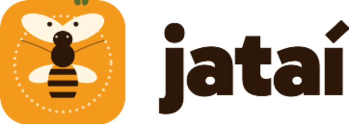
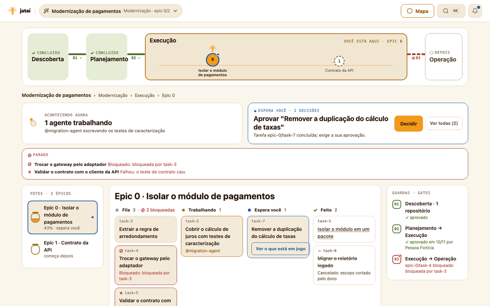
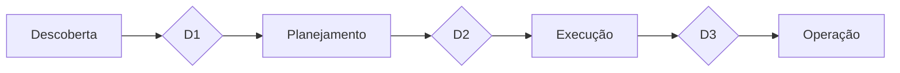
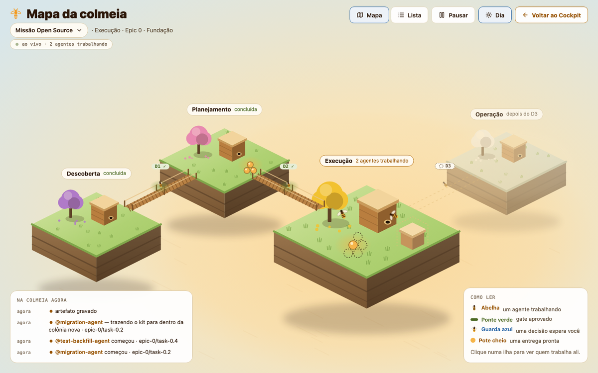
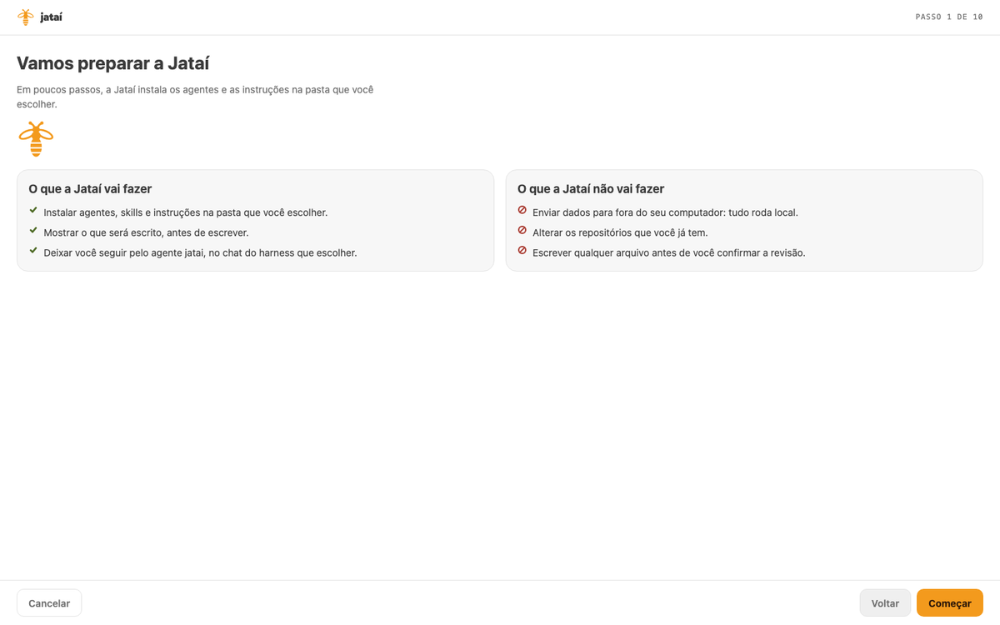

<p align="center">
  
</p>

<h1 align="center">Agentes de IA com método. Decisões com você.</h1>

<p align="center">
  A Jataí é uma extensão de código aberto para o VS Code que coloca agentes de IA
  dentro de um método de entrega. O agente escreve, testa e documenta;
  <strong>você decide o que passa</strong>.
</p>

<p align="center">
  <a href="https://github.com/rafaelnicolett/jatai/actions/workflows/ci.yml"></a>
  
  
  
  
</p>

<p align="center">
  <picture>
    <source media="(prefers-color-scheme: dark)" srcset="media/readme/cockpit-escuro.png">
    
  </picture>
</p>

<p align="center">
  <sub>O Cockpit mostra onde a iniciativa está, quem trabalha, o que espera você e o que está parado. Projeto fictício.</sub>
</p>

<p align="center">
  <a href="#o-problema">O problema</a> ·
  <a href="#a-proposta">A proposta</a> ·
  <a href="#como-funciona">Como funciona</a> ·
  <a href="#o-que-você-vê">O que você vê</a> ·
  <a href="#comece-em-5-minutos">Comece em 5 minutos</a> ·
  <a href="#aberta-de-verdade">Aberta de verdade</a> ·
  <a href="#feita-no-brasil">Feita no Brasil</a> ·
  <a href="#documentação">Documentação</a>
</p>

---

## O problema

Ferramentas de IA escrevem código mais rápido do que um time consegue revisar. Sem método, o resultado é previsível:

- **big bang**: um agente muda dez arquivos de uma vez e ninguém consegue revisar;
- **decisão sem dono**: a escolha mora no chat e some quando a sessão fecha;
- **nenhum ponto de parada**: o agente avança sozinho e o merge é a primeira vez que alguém vê o todo;
- **refactor sem rede**: sem um teste que fixe o comportamento atual, mudar é aposta.

O problema não é a IA escrever. É não haver um lugar para o estado, um momento para a decisão e uma prova do que mudou.

## A proposta

A Jataí é um **método antes de ser uma ferramenta**. A extensão instala o método na sua pasta e acompanha o trabalho:

- **Descoberta só lê.** O sistema é entendido antes de ser tocado.
- **Planejamento decide.** O que muda, em que ordem, com qual risco.
- **Execução prova.** Testes primeiro, mudança incremental, nada de big bang.
- **Operação sustenta.** O que foi entregue continua de pé.
- **Três gates humanos.** D1, D2 e D3. Nenhum agente passa de um gate sem você.
- **Estado em arquivos.** O progresso, as decisões e as evidências ficam em `.github/artifacts/`, versionados com o código.
- **Um agente por contexto.** O agente de Faturamento não carrega o contexto de Sinistros.

> O nome vem da jataí, abelha nativa sem ferrão. A guarda da colônia inspeciona quem entra. Na Jataí, nenhum agente passa da guarda sem você.

## Como funciona



| Etapa | O que acontece | O que fica registrado |
|---|---|---|
| **Descoberta** | agentes leem o código, o domínio e os riscos; nada é alterado | assessment, mapa de domínio, dívida técnica |
| **Planejamento** | roadmap, ADRs e matriz de risco; o escopo é decidido | plano, decisões, ordem das mudanças |
| **Execução** | teste de caracterização, refactor e feature em PRs pequenos | relatórios, testes, commits |
| **Operação** | CI/CD, observabilidade, incidentes e sustentação | runbooks, métricas, histórico |

Cada gate tem uma pergunta simples: **o que está em jogo, e você aprova?** O Cockpit mostra a resposta em texto, com o motivo e o nome de quem decidiu.

## O que você vê

### O Cockpit

<p align="center">
  <picture>
    <source media="(prefers-color-scheme: dark)" srcset="media/readme/cockpit-escuro.png">
    
  </picture>
</p>

A tela **Agora** responde em três segundos: onde a iniciativa está, quem está trabalhando, o que espera você e o que travou — com o motivo em texto, nunca só uma cor.

### O mapa da colmeia

<p align="center">
  <picture>
    <source media="(prefers-color-scheme: dark)" srcset="media/readme/mapa-escuro.png">
    
  </picture>
</p>

Cada etapa é uma ilha, cada gate é uma ponte, cada agente trabalhando é uma abelha. A guarda acesa é uma decisão que espera você. O mapa **só acompanha**: nada nele aprova ou grava.

### O Wizard

<p align="center">
  <picture>
    <source media="(prefers-color-scheme: dark)" srcset="media/readme/wizard-escuro.png">
    
  </picture>
</p>

O Wizard prepara a pasta, mostra o que será escrito e **não altera seus repositórios** antes da revisão. Ele existe para o primeiro dia não ser uma surpresa.

## Comece em 5 minutos

1. **Instale a extensão.** No VS Code, procure **Jataí** no Marketplace ou rode:
   ```sh
   code --install-extension jatai.jatai
   ```
   Se a loja ainda não listar a 1.0.0, baixe o `.vsix` na página de [releases](https://github.com/rafaelnicolett/jatai/releases).

2. **Abra a pasta do projeto.** Pode ser um sistema que já existe ou uma pasta vazia para começar do zero.

3. **Rode o Wizard.** Abra a paleta (`Cmd/Ctrl+Shift+P`) e escolha **Jataí: Initialize Delivery Kit**. Selecione **Projeto existente** para analisar o que já existe, ou **Projeto novo** para gerar a estrutura.

4. **Comece pelo agente `jatai`.** No chat do seu harness:
   - **Claude Code:** chame `@jatai`;
   - **GitHub Copilot:** selecione o agente **jatai** no seletor e escreva a intenção.

   Diga o que quer fazer — por exemplo, *"mapear o projeto"*. O `jatai` valida os pré-requisitos e chama o agente da etapa certa.

5. **Aprove o D1.** O agente para e mostra o que encontrou. Você decide se a Descoberta está concluída. A partir daí, **Planejamento → D2 → Execução → D3 → Operação** seguem o mesmo contrato.

> O primeiro comando é sempre o mesmo. O que muda é o ponto de partida; o método não muda.

## O que fica no seu repositório

```
.github/artifacts/          # estado, decisões e evidências — a fonte da verdade
  assessment/               # Descoberta
  planning/                 # Planejamento, ADRs e risco
  execution/                # relatórios de execução e testes
.claude/agents/             # agentes (Claude Code) — ou .github/agents/ no Copilot
.claude/skills/             # skills reutilizáveis
AGENTS.md                   # o ponto de entrada, lido pelo harness
jatai.config.yaml           # o workspace, os repositórios e o kit instalado
```

Tudo é texto, versionado com o código. O chat pode fechar; o estado não fecha com ele.

## Aberta de verdade

- **MIT.** Use, mude, distribua e integre. A licença está em [LICENSE](LICENSE).
- **Local por padrão.** O núcleo não envia dados para fora. Um teste de zero egress roda no CI a cada mudança.
- **Sem telemetria escondida.** Não há coleta de uso, prompt ou conteúdo de arquivo.
- **Seu modelo, seu harness.** Hoje Claude Code e GitHub Copilot; a estrutura é Markdown e novos harnesses entram por adaptador. O modelo é escolha sua.
- **Sem lock-in.** O estado é YAML e Markdown no seu repositório. Se a extensão sumir, o método continua legível.
- **API de extensão consentida.** Um serviço próprio pode se conectar à telemetria, aos templates ou à sincronização de artefatos — só depois de um consentimento por workspace, revogável. O núcleo nunca faz rede; quem faz é a extensão companheira.

## Feita no Brasil

A Jataí é uma abelha nativa sem ferrão (*Tetragonisca angustula*). O símbolo se chama **Guarda**: a abelha que fica na entrada da colônia e inspeciona quem entra. As quatro faixas de mel do abdômen são as quatro etapas do método; a ponta redonda, sem ferrão, é a mudança segura e reversível.

A metodologia, a documentação e o produto são escritos em português, no Brasil. A ambição é simples: **tecnologia brasileira, aberta, para times que querem usar IA sem abrir mão de método**.

## Para quem

- **Times com sistema existente:** a Descoberta entende antes de mexer; a Execução troca em passos que você aprova, com um teste que fixa o comportamento atual.
- **Times começando um projeto:** o contrato vem antes do código, cada decisão de arquitetura vira ADR e cada agente cuida da sua stack.
- **Consultorias e tech leads:** o trabalho fica auditável no repositório, não na memória de uma sessão de chat.

## Documentação

- [A metodologia](https://github.com/rafaelnicolett/jatai/tree/main/docs/metodologia) — as quatro etapas, os gates e o estado em arquivos.
- [Catálogo de agentes](https://github.com/rafaelnicolett/jatai/tree/main/docs/agentes) — o que cada agente faz e quando entra.
- [Arquitetura](https://github.com/rafaelnicolett/jatai/blob/main/docs/arquitetura.md) — o núcleo, a casca e as fronteiras.
- [Decisões](https://github.com/rafaelnicolett/jatai/tree/main/docs/decisoes) — as ADRs que moldaram o projeto.
- [API de extensão](https://github.com/rafaelnicolett/jatai/blob/main/docs/api-de-extensao.md) — como um serviço próprio se conecta, com consentimento.
- [Como contribuir](https://github.com/rafaelnicolett/jatai/blob/main/CONTRIBUTING.md) — ambiente, testes e o caminho de um PR.
- [Código de conduta](https://github.com/rafaelnicolett/jatai/blob/main/CODE_OF_CONDUCT.md) e [segurança](https://github.com/rafaelnicolett/jatai/blob/main/SECURITY.md).

## Desenvolvimento

Requisitos: Node 20 e VS Code 1.90+.

```sh
npm ci
npm --prefix webview-ui ci

npm run ci:local        # typecheck, lint, testes, build e .vsix
npm run test            # testes do host
npm run test:webview    # testes do webview
npm run package         # gera o .vsix
```

As telas deste README são capturadas do mock visual com o Chrome, pelo script
`webview-ui/scripts/capture-readme.mjs`; as imagens ficam em `media/readme/`.

## Limitações

- **O Cockpit e o Wizard vivem no VS Code.** O método, os agentes e os artefatos não dependem do editor; a interface depende.
- **Dois harnesses hoje:** Claude Code e GitHub Copilot. O suporte a outros harnesses entra por adaptador, com testes de paridade — OpenCode está no backlog.
- **Windows no CI:** a suíte roda em Linux e macOS na 1.0.0; o job do Windows está em portabilidade experimental. A extensão funciona no Windows — o que falta é a suíte de testes no runner, não o produto.
- **Sem serviço hospedado.** A Jataí é local; não há conta, nuvem ou painel web na 1.0.0.
- **A 1.0.0 é o começo.** O que está aqui é o método funcionando de ponta a ponta, com as arestas documentadas.

## Licença

[MIT](LICENSE). A Jataí é aberta para uso, estudo, mudança e distribuição.
