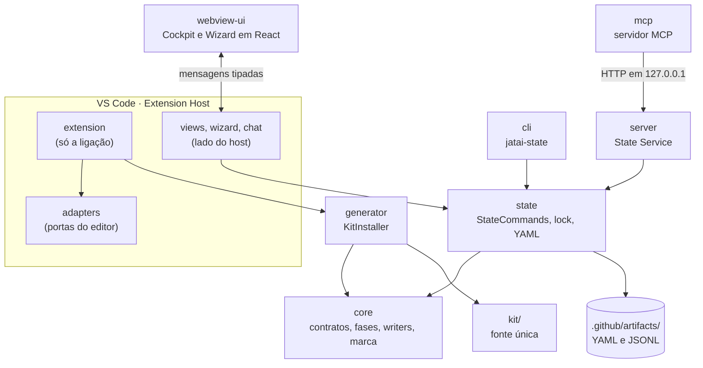

# Arquitetura

Uma visão do código da Jataí para quem vai ler, mudar ou contribuir. Ela resume as
decisões da [ADR-0016](decisoes/0016-arquitetura-alvo-nucleo-funcional-casca-imperativa.md)
(a forma do código) e da [ADR-0017](decisoes/0017-estado-jatai-yaml-fonte-unica-sem-sqlite.md)
(o estado). Para a metodologia que o código serve, comece pelo
[guia da metodologia](metodologia/README.md).

## A ideia: núcleo funcional e casca imperativa

A Jataí é, no fundo, um catálogo (as etapas, as fases, os contratos dos arquivos) mais
a transformação de YAML. Por isso a arquitetura é simples:

- **o núcleo é puro.** Ele não importa a API do VS Code nem módulos do Node, e não faz
  I/O. Recebe dados e devolve dados, então roda em qualquer lugar e se testa sem
  nada de fora;
- **a casca é imperativa e fina.** Ela liga o núcleo ao mundo (arquivos, rede local,
  git, o editor) por **portas**, interfaces pequenas que o código de produção
  implementa de um jeito e os testes de outro;
- **o monólito é modular.** As fronteiras são pastas de `src/`, com regras de
  dependência conferidas no CI. A separação em pacotes npm só vem quando as regras
  estiverem todas em erro.

## Mapa do código

| Pasta | O que é |
|---|---|
| `src/core/` | o núcleo puro: marca, contratos dos arquivos de estado, o catálogo único de fases, planos, writers e validação |
| `src/state/` | o estado: o `StateCommands` único, o cliente único do State Service, o lock e o repositório YAML |
| `src/cli/` | o CLI de estado (`jatai-state`): os verbos de escrita, de leitura e de gate |
| `src/server/` | o State Service local (HTTP e SSE em `127.0.0.1`), o barramento de eventos e o observador de `runs/` |
| `src/mcp/` | o servidor MCP, um cliente fino do State Service |
| `src/generator/` | a instalação do kit: uma fachada sobre o `KitInstaller`, os adaptadores de harness (Claude Code e Copilot) e o gerador do projeto novo. Não importa o `vscode` |
| `src/extension.ts`, `src/extension/` | só a ligação: o container, as portas e um módulo por comando ou etapa de inicialização |
| `src/adapters/` | as implementações das portas para o VS Code |
| `src/chat/` | o guia do chat, que mostra onde a iniciativa está e encaminha para o agente `jatai` |
| `src/views/`, `src/wizard/` | o lado do host do Cockpit e do Wizard |
| `webview-ui/src/` | as telas em React: `design-system/` (a folha, sem store nem features), `apps/cockpit/`, `apps/wizard/`, `features/` e `store/` |
| `kit/` | a fonte única do kit de agentes: manifesto, conteúdo, variantes e schemas |
| `tests/` | o golden master, os contratos, a caracterização, os cenários BDD e os testes unitários |

## Como as peças se falam

As setas dizem "depende de". Dois caminhos mostram o desenho em ação.

**Uma escrita de estado.** Um agente chama uma tool do servidor MCP, ou roda um verbo
do CLI. Os dois chegam ao mesmo `StateCommands`, que valida a entrada (o vocabulário de
status, os campos obrigatórios), pega o lock do arquivo e grava o YAML. O State
Service publica o evento, e o Cockpit atualiza. Se o State Service não está no ar, o
CLI grava direto no YAML, sob o mesmo lock.

**Uma instalação de kit.** O Wizard (ou o comando de instalação) chama o gerador. O
`KitInstaller` lê a edição certa do kit (projeto novo ou existente), o adaptador do
harness (`ClaudeAdapter` ou `CopilotAdapter`) escolhe a pasta, o orquestrador e as
instruções do host, e o resultado é gravado no projeto, com o servidor MCP configurado,
os hooks de atividade e um `kit.lock.json` que registra o que foi instalado.

## Regras de dependência

As regras ficam em `.dependency-cruiser.cjs` e rodam com `npm run arch`, no CI e no
`ci:local`. As principais:

| Regra | O que impede |
|---|---|
| `core-is-pure` | `src/core` importar `vscode` ou um módulo do Node. É a única que reprova o build hoje |
| `core-is-root` | `src/core` depender de qualquer outra pasta de `src/` |
| `cli-no-generator` | o CLI alcançar o gerador ou a casca do VS Code |
| `ds-is-leaf` | o design system do webview importar features, store ou apps |
| `no-cross-feature` | uma feature do webview importar outra |
| `no-circular` | ciclos de importação |

As regras que ainda têm código em transição avisam, e cada uma vira erro na mudança que
zera os avisos dela. Até lá, os barrels de reexportação de `src/data/` preservam os
caminhos antigos (é Branch by Abstraction, na prática).

## Fronteiras de confiança

- **Tudo é local.** A extensão não envia dado nenhum para fora da máquina, e dois testes
  de contrato vigiam isso: um procura URL remota no código, nos bundles e na política de
  segurança das telas, e o outro roda os fluxos principais com a rede cortada no socket
  ([ADR-0015](decisoes/0015-v1-aberta-local-sem-envio-de-dados.md)).
- **O State Service só escuta em `127.0.0.1`.** O token vive em `server.json`, que o
  `.gitignore` gerado deixa fora do git.
- **A extensão só ativa em workspace da Jataí e só roda em workspace confiável.**
- **Os agentes só falam com o estado por tools MCP ou pelo CLI**, nunca direto com a API
  ([ADR-0004](decisoes/0004-mcp-fronteira-obrigatoria-agente-estado.md)).
- **Outras extensões** se plugam pelas portas da API pública, e só com o consentimento
  da pessoa, por workspace ([ADR-0023](decisoes/0023-api-de-extensao-portas-com-consentimento.md)).

## O kit

`kit/` é a **fonte única** dos agentes, das skills e das instruções. O
`kit.manifest.yaml` diz o que cada edição recebe, e `npm run build:kit` gera as duas
edições em `dist/kit/`, que não vão para o git e são o que o gerador lê e o `.vsix`
leva. Os bundles do CLI e do servidor MCP (`kit/scripts/`) são gerados do código em
`src/` e versionados, e o CI reprova se eles divergirem da fonte. Para criar um agente
ou uma skill, veja [criar agentes e skills](criar-agentes-e-skills.md).

## A rede de segurança

Mudar a estrutura sem mudar o comportamento depende de quatro tipos de teste, em
`tests/`:

- **golden master** (`tests/golden/`): congela, byte a byte, o que a Jataí instala e o
  que o CLI responde e grava. Um PR de refactor nunca o altera;
- **contratos** (`tests/contract/`): os caminhos e schemas dos artefatos, os ids de
  comando, as settings, o protocolo entre a extensão e as telas, o CLI, o MCP e o HTTP;
- **caracterização** (`tests/characterization/`): o comportamento de hoje de módulos que
  não tinham teste;
- **cenários BDD** (`tests/features/`): o comportamento novo, em Gherkin e em português,
  escrito antes do código.

Veja [golden master](metodologia/praticas/golden-master.md) e
[BDD](metodologia/praticas/bdd.md). As regras para contribuir estão no
[CONTRIBUTING.md](../CONTRIBUTING.md).
