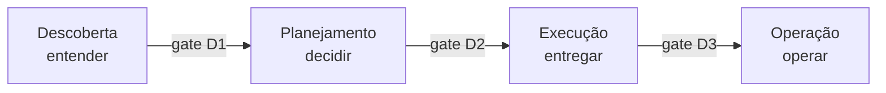

# A metodologia da Jataí

A Jataí é um método de entrega executado por agentes de IA, com pontos fixos em
que uma pessoa precisa dizer "sim, pode seguir". Os agentes analisam, planejam,
escrevem testes e mudam código. Você decide nos **gates** (pontos de aprovação
humana), e tudo o que foi descoberto ou decidido fica registrado em arquivo, não
só na conversa.

Este guia explica o método. Ele vale para o Claude Code e para o GitHub Copilot, e
faz sentido sem a extensão do VS Code: o Cockpit e o mapa são uma janela sobre os
mesmos arquivos.

## Quatro etapas, nesta ordem

| Etapa | A pergunta | Fecha com |
|---|---|---|
| Descoberta (`discovery`) | O que existe hoje? | gate D1 |
| Planejamento (`planning`) | O que mudar, em que ordem e por quê? | gate D2 |
| Execução (`execution`) | Como mudar sem quebrar o que existe? | gate D3 |
| Operação (`operation`) | Como manter o que está no ar? | não fecha: é contínua |

Os arquivos que a Jataí instala no seu projeto usam os nomes em inglês das etapas
(`discovery`, `planning`, `execution`, `operation`). Este guia usa os nomes em
português da interface e mostra o nome em inglês quando ele aparece em arquivo.

O ponto de partida pode ser um projeto que já existe ou um projeto novo
([brownfield e greenfield](brownfield-e-greenfield.md)). A ordem não muda:
entender, decidir, construir e operar, sempre com registro.

## Três ideias

1. **Cada etapa começa quando uma pessoa aprova a anterior.** Um agente que
   termina não passa adiante sozinho: ele para num gate e espera você.
   ([Gates](gates.md), [humano no circuito](humano-no-circuito.md))
2. **O estado mora em arquivos.** O que os agentes descobrem e o que você decide
   fica em `.github/artifacts/`, em YAML e Markdown, versionável e legível sem
   nenhuma ferramenta. O Cockpit lê e escreve nos mesmos arquivos e nunca guarda
   uma segunda versão da verdade. ([Estado em arquivos](estado-em-arquivos.md))
3. **A mudança é incremental e reversível.** Nada de reescrita nem de troca em
   bloco: cada passo vale por si e tem como voltar. ([Práticas](praticas/README.md))

## Onde ler cada assunto

| Quero entender | Leia |
|---|---|
| O que cada etapa faz e produz | [Etapas](streams.md) |
| Quando você aprova e o que cada gate exige | [Gates](gates.md) |
| Onde fica cada informação | [Estado em arquivos](estado-em-arquivos.md) |
| Quem são os agentes e como se falam | [Agentes](agentes.md) e o [catálogo](../agentes/README.md) |
| Projeto existente ou projeto novo | [Brownfield e greenfield](brownfield-e-greenfield.md) |
| O que fica com você | [Humano no circuito](humano-no-circuito.md) |
| Feature, modernização e hotfix | [Iniciativas](iniciativas.md) |
| Strangler, Expand-Contract, Parallel Run, BDD, testes de caracterização e golden master | [Práticas](praticas/README.md) |
| Uma palavra que não conheço | [Glossário](glossario.md) |

Para ver o método funcionando num projeto de exemplo, gere o
[workspace demo](../../demo/README.md).

## O que a Jataí nunca faz

- Escrever código de feature antes de a Descoberta ser aprovada.
- Refatorar sem teste de caracterização cobrindo o comportamento de hoje.
- Trocar tudo de uma vez: o caminho é sempre incremental.
- Misturar refactor e feature no mesmo PR.
- Modificar arquivo durante a Descoberta, que só lê.
- Pular o Planejamento entre a Descoberta e a Execução.
- Aprovar um gate no seu lugar. Agente lê o estado do gate, nunca o aprova.
- Enviar dado para fora da sua máquina. A Jataí é 100% local.
