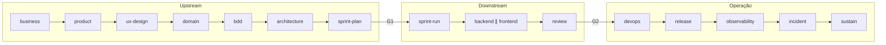

# Projeto existente ou projeto novo

A Jataí tem duas portas de entrada, e a primeira decisão prática é saber em qual
delas você está. O método por trás é o mesmo: entender, decidir, construir e
operar, sempre nessa ordem, com registro em cada etapa e a sua aprovação nos
gates.

| | Projeto existente (**brownfield**) | Projeto novo (**greenfield**) |
|---|---|---|
| Ponto de partida | o sistema já existe e já roda | o projeto ainda não existe |
| Primeira conversa | a Jataí aprende o que está lá, antes de tocar em qualquer linha | você descreve o que quer construir, e a Jataí monta o caminho |
| Etapas | Descoberta, Planejamento, Execução, Operação | Upstream, Downstream, Operação |
| Gates | D1, D2 e D3 | G1 e G2 |
| Quem valida o gate | você | você, com os guardiões `@stream-align` e `@arch-cross` |
| O que a Jataí instala | os agentes, as skills e as instruções do host, sem tocar no seu código | a estrutura do projeto, com os agentes, as instruções do host e uma primeira iniciativa |

## Projeto existente

É o caso de quem tem um sistema em produção e quer mudá-lo sem medo. O trabalho
começa com um inventário curto: a lista dos repositórios, um por vez, com a origem,
a branch ou tag e quanto investigar em cada um. Um projeto com um repositório é um
projeto com N = 1: o fluxo é sempre o mesmo.

Depois vêm as quatro etapas descritas em [etapas](streams.md). O que muda o jogo:

- a **Descoberta** vem antes de tudo e só lê;
- o **código existente manda**: os agentes escrevem no padrão que a Descoberta
  encontrou, mesmo que um deles acharia outro melhor;
- mudar o padrão é uma **iniciativa de modernização** à parte, nunca uma melhoria
  de passagem;
- **teste de caracterização antes de refactor**, e migração sempre em etapas.

## Projeto novo

Aqui não existe "escrever o PRD sozinho" nem "decidir a stack no vácuo": você
responde a perguntas, e a Jataí monta o caminho. O fluxo tem as fases abaixo.

- **Upstream** define o que construir e por quê: o Business Brief, o PRD, o
  desenho de telas, o domínio, os cenários BDD, a arquitetura (ADRs, contrato de
  API e diagramas) e o plano da sprint.
- **Downstream** constrói e valida. O backend e o frontend andam em paralelo, no
  agente da stack que você escolheu na configuração (por exemplo
  `@backend-python-api` ou `@frontend-react`), e o `@reviewer` fecha com a revisão.
- **Operação** publica e mantém, com CI/CD, release, observabilidade, incidente e
  sustentação.

O **G1** (Upstream para Downstream) e o **G2** (Downstream para Operação) só fecham
com os guardiões de acordo: `@stream-align` confere se o que entra em produção é o
que foi pedido, e `@arch-cross` confere se a arquitetura está coerente de ponta a
ponta entre as stacks. Os aprendizados da Operação voltam para o Upstream, pelo
orquestrador, como feature nova ou ADR.

## Como escolher

- Existe código rodando que vai receber mudança? Projeto existente.
- Vai começar do zero? Projeto novo.

O Wizard da extensão pergunta isso logo no início, e dá para mudar de ideia
depois: a escolha não é permanente.
