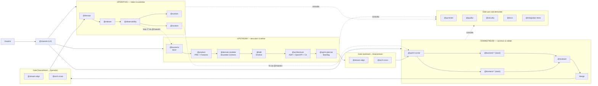

# Delivery Flow End-to-End

Ciclo completo coberto pela {{brand.displayName}}, organizado em **3 streams** com **2 gates
guardiões** entre eles.

## Tabela de fases

### Upstream (descobrir & definir)

| # | Fase | Agente | Saída-chave |
|---|---|---|---|
| 1 | Business | `@business` | Business Brief (problema, ROI, stakeholders) |
| 2 | Discovery | `@product` | PRD + Feature List + hipóteses |
| 3 | Domain Modeling | `@domain-modeler` | Bounded contexts, agregados, eventos, linguagem ubíqua |
| 4 | BDD Specification | `@bdd` | `.feature` files + critérios de aceite |
| 5 | Architecture | `@architecture` | ADR + OpenAPI + C4 (arquitetura de referência clean) |
| 6 | Planning | `@sprint-planner` | Subtarefas com DoR |

### Gate Upstream → Downstream (`@stream-align` + `@arch-cross`)

**Exit contract:**
- ✅ Cenários Gherkin para cada feature
- ✅ Contrato OpenAPI publicado e versionado
- ✅ ADR aprovado
- ✅ Subtarefas no DoR
- ✅ Estratégia de teste documentada
- ✅ `@stream-align`: PRD → BDD → backlog estão coerentes com o Brief
- ✅ `@arch-cross`: OpenAPI cobre as features e está consistente com as stacks selecionadas

### Downstream (construir & validar)

| # | Fase | Agente | Saída-chave |
|---|---|---|---|
| 1 | Sprint Execution | `@sprint-runner` | Status, impedimentos, gestão da sprint |
| 2a | Backend Build | `@backend-{java\|dotnet\|python-api\|python-agentic}` | Código + unit tests (paralelo a 2b) |
| 2b | Frontend Build | `@frontend-{react\|flutter\|android\|ios}` | Código + unit tests (paralelo a 2a) |
| 3 | Review | `@reviewer` | Aprova ou requestChanges |
| 4 | Merge | `@sprint-runner` | PR mergeado, ticket fechado |

**Princípios:** Contract First · Backend ∥ Frontend · QA contínuo (side-car)
· Integration Tests automáticos ao fechar back+front.

### Gate Downstream → Operation (`@stream-align` + `@arch-cross`)

**Exit contract:**
- ✅ PR mergeado, CI verde
- ✅ Cobertura ≥ threshold
- ✅ Integration tests verdes
- ✅ Sem CVE crítico pendente
- ✅ CHANGELOG/release notes atualizados
- ✅ `@stream-align`: features entregues batem com critérios de aceite Gherkin
- ✅ `@arch-cross`: implementação respeita OpenAPI; arquitetura cross-stack íntegra

### Operation (rodar & sustentar)

| # | Fase | Agente | Saída-chave |
|---|---|---|---|
| 1 | Pipeline | `@devops` | Build/test/deploy automatizados |
| 2 | Release | `@release` | Versão tagueada + release notes |
| 3 | Observability | `@observability` | Métricas, logs, alertas, SLOs |
| 4 | Incident | `@incident` | Runbook + post-mortem |
| 5 | Sustain | `@sustain` | Patch security, upgrade dependências |

**Loop:** aprendizados (`@observability`, `@incident`) escalam via `@maestro`
para Upstream, gerando novas features ou ADRs corretivos.

## Side-cars (sob demanda)

| Side-car | Quando | Reusa skills |
|---|---|---|
| `@qa-tester` | Build do Downstream | `bdd-step-definitions`, `playwright-tests` |
| `@quality` | Gates de entrada/saída de stream | `quality-gate` |
| `@security` | Mudanças de código/infra/dados | `security-best-practices`, `security-cve-checker` |
| `@docs` | Fases que produzem artefato | `docs-writer` |
| `@integration-tests` | Quando back+front fecham | — |

## Registro de atividade do delivery

Cada mudança de estado e cada passo de um agente deixam um evento em
`.github/artifacts/runs/*.jsonl`, uma linha por evento. Esses arquivos ficam
**na sua máquina**: a pasta `runs/` está no `.gitignore` gerado, e a
{{brand.displayName}} não envia nenhum deles para fora. O Cockpit os lê em
tempo real, para mostrar o que está rodando, o que espera por você e o que
travou.

Quem grava:

| Quem | Como |
|---|---|
| O estado | Toda mudança feita pelo CLI (`node .github/scripts/{{brand.files.cli}} ...`), pelo servidor MCP e pelo State Service da extensão grava um evento |
| Os agentes | Pelo terminal, com `node .github/scripts/{{brand.files.cli}} runs append ...`. O CLI valida e grava sob lock; ninguém escreve o `.jsonl` à mão |
| O Claude Code | Pelos hooks que o kit instala em `.claude/settings.json`: início e fim de subagentes e escrita de artefatos em `.github/artifacts/` |
| O Copilot | Por um observador de `.github/artifacts/` na extensão, que registra cada artefato gravado enquanto ela está aberta no workspace |

O evento guarda só metadados: o tipo, o agente, a fase, o repositório, o
horário e, quando há, o caminho do artefato. Nunca guarda o conteúdo de um
arquivo, um prompt nem a saída de uma ferramenta, e a mensagem vai até 140
caracteres.
