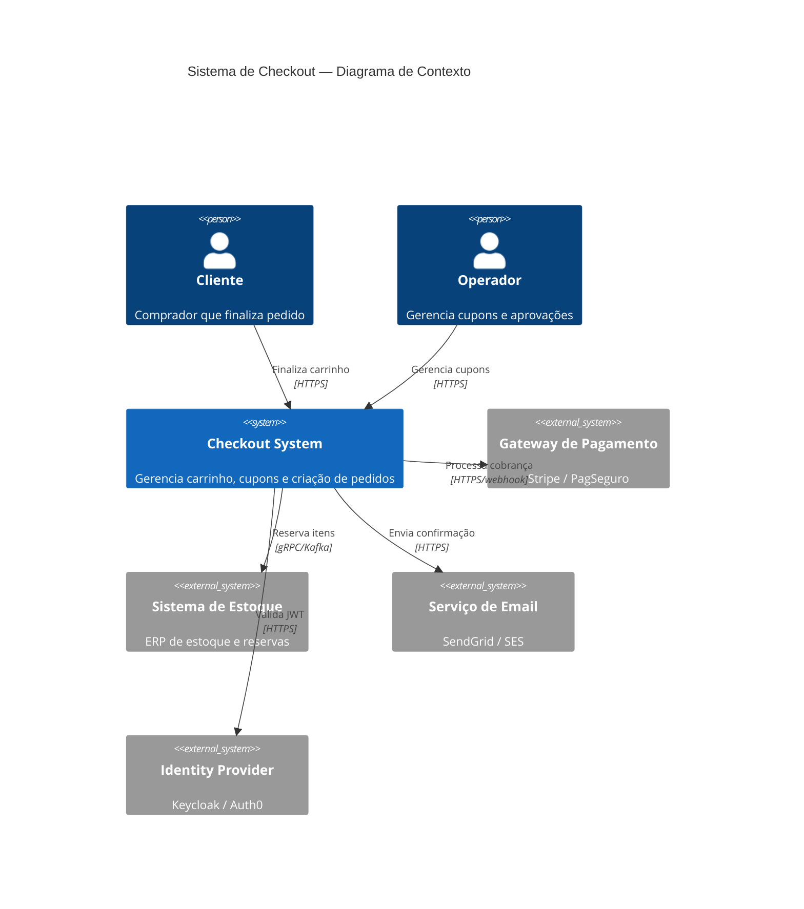
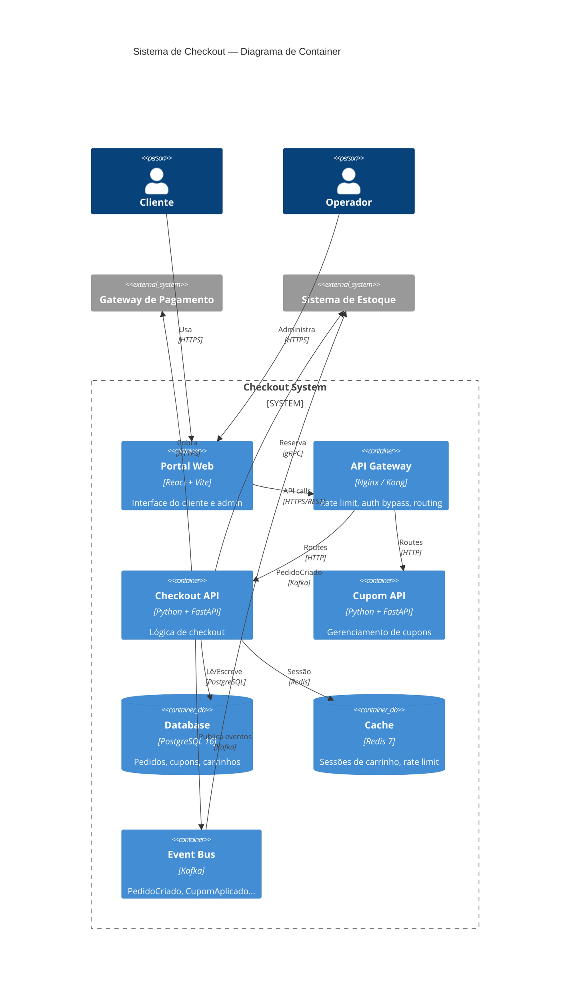
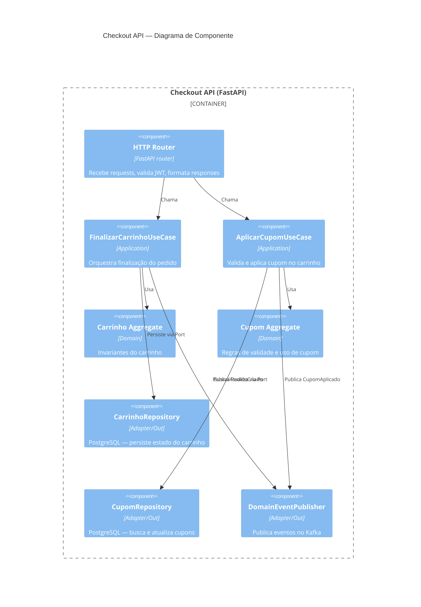
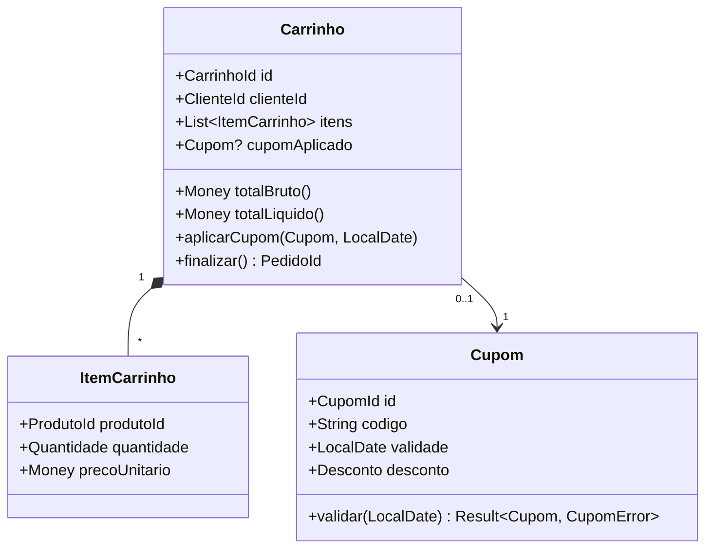
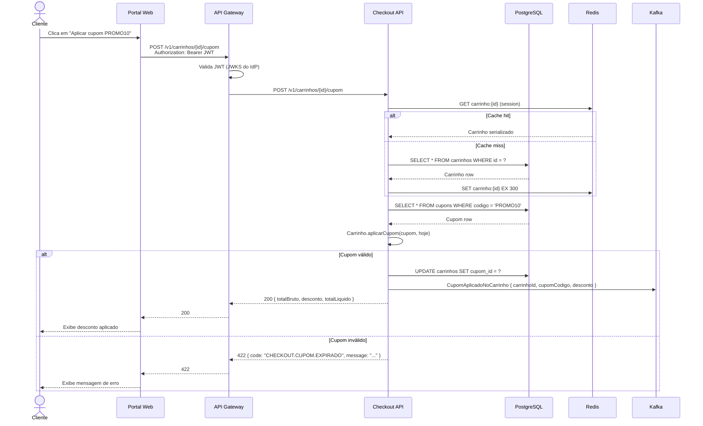
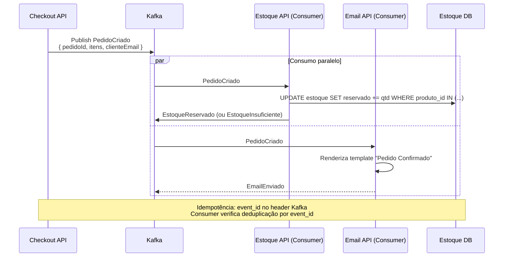
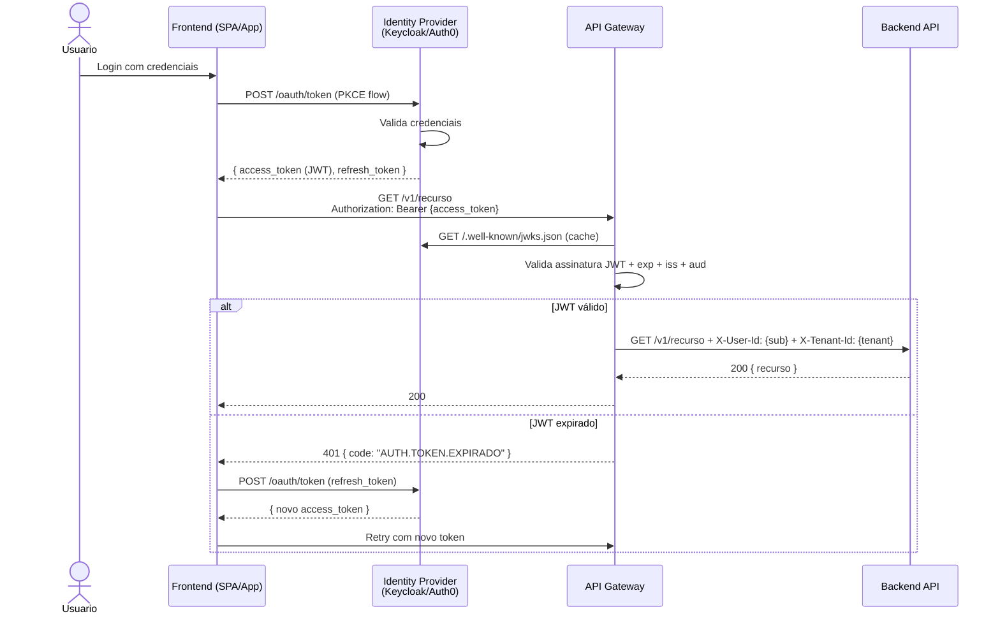

# Skill: openapi-governance

## 1. Princípios fundamentais
- **Contract-first**: OpenAPI é a fonte da verdade. Código implementa o contrato — nunca o contrário.
- **Versionamento semver** (`/v1/`, `/v2/`); breaking change = nova major.
- **Lint obrigatório** (Spectral ou similar) no CI.
- **Geração de SDK** para clientes (backends e frontends) a partir do contrato.
- **Linguagem ubíqua**: `operationId`, schemas e parâmetros em UL do domínio.

## 2. Padrões transversais

### 2.1 Error Envelope (único por sistema)
```json
{
  "code": "DOMINIO.CONTEXTO.CODIGO_ERRO",
  "message": "Mensagem legível para humanos",
  "details": [
    { "field": "cupom", "issue": "expirado", "value": "PROMO10" }
  ],
  "traceId": "4b3e2a1f..."
}
```
- `code`: hierárquico com pontos. Ex: `CHECKOUT.CUPOM.EXPIRADO`
- `message`: nunca expõe stack trace ou nome de tabela
- `details`: lista de problemas por campo (ideal para validação)
- `traceId`: propagado do header `X-Trace-Id`

### 2.2 Headers obrigatórios
- Requisição: `X-Request-Id` (UUID gerado pelo cliente), `Authorization: Bearer <jwt>`
- Resposta: `X-Trace-Id` (propagado do span OTel), `X-Request-Id` (ecoado)

### 2.3 Paginação cursor-based
```yaml
parameters:
  - name: cursor
    in: query
    schema: { type: string }
    description: Cursor opaco da página anterior (base64)
  - name: limit
    in: query
    schema: { type: integer, default: 20, maximum: 100 }
responses:
  '200':
    content:
      application/json:
        schema:
          properties:
            items: { type: array, items: { $ref: '#/components/schemas/Pedido' } }
            next_cursor: { type: string, nullable: true }
            total: { type: integer }
```

### 2.4 Datas e IDs
- Datas: ISO 8601 UTC (`2024-01-15T10:30:00Z`)
- IDs: UUID v4 (string). Nunca integer auto-increment na API pública.
- Monetário: integer em centavos (evita float) ou `string` com ponto (`"19.90"`)

### 2.5 Versionamento de API
- URL path versioning: `/v1/`, `/v2/`
- Breaking changes (novos major): novo endpoint paralelo, deprecation notice, período de sunset
- Non-breaking: adicionar campo opcional, adicionar endpoint, relaxar validação

## 3. Validações no gate (`@arch-cross`)
- [ ] Lint OpenAPI verde (Spectral + `spectral:oas` ruleset)
- [ ] Sem breaking change não intencional vs. versão anterior (`oasdiff`)
- [ ] Cobre todas as features do `feature-list.md`
- [ ] Backend implementa todos os endpoints (schemathesis confirma)
- [ ] Front consome via SDK gerado, não chamadas raw
- [ ] Error envelope único em todos os endpoints de erro
- [ ] Paginação cursor-based em todas as listagens
- [ ] Auth declarada em todos os endpoints (SecurityScheme)

## 4. Modelos C4 — obrigatórios para cada serviço

O modelo C4 (C4Model.com) define 4 níveis de abstração arquitetural.
O `@architecture` produz os níveis 1-3 antes do downstream.

### 4.1 Nível 1 — Context (visão macro)

Mostra o **sistema como caixa preta** e seus atores/sistemas externos.

```markdown
<!-- docs/architecture/c4-context.md -->
## C4 — Nível 1: Context


```

**Checklist nível 1:**
- [ ] Todos os atores humanos identificados
- [ ] Todos os sistemas externos identificados
- [ ] Protocolos de comunicação rotulados
- [ ] Sistema principal descrito com responsabilidade clara

### 4.2 Nível 2 — Container (serviços e tecnologias)

Mostra os **containers** (apps, databases, microserviços) dentro do sistema.

```markdown
<!-- docs/architecture/c4-container.md -->
## C4 — Nível 2: Container


```

**Checklist nível 2:**
- [ ] Todos os microserviços identificados com tecnologia
- [ ] Databases, caches e message brokers presentes
- [ ] Protocolos entre containers rotulados
- [ ] Frontends e API Gateways incluídos

### 4.3 Nível 3 — Component (módulos internos de um serviço)

Mostra os **componentes principais** dentro de um container específico.
Produza para cada serviço **core** (classificado como Core Subdomain).

```markdown
<!-- docs/architecture/c4-component-checkout-api.md -->
## C4 — Nível 3: Component — Checkout API


```

**Checklist nível 3:**
- [ ] Componentes de cada camada hexagonal visíveis
- [ ] Ports (interfaces) distinguíveis de adapters
- [ ] Domínio sem dependência de adapters
- [ ] Use cases como orquestradores explícitos

### 4.4 Nível 4 — Code (opcional)

Diagramas de classe para agregados complexos. Use Mermaid `classDiagram`.
Só para domínios com muitas invariantes cruzadas (ex: sistema financeiro).



## 5. Diagramas de sequência — fluxos críticos

Produza um diagrama `sequenceDiagram` (Mermaid) para cada **fluxo crítico**
do sistema. Mínimo: autenticação/autorização + fluxo principal do BC core.

### 5.1 Template de fluxo síncrono (REST)

```markdown
<!-- docs/architecture/seq-aplicar-cupom.md -->
## Sequência — Aplicar Cupom


```

### 5.2 Template de fluxo assíncrono (Event-driven)

```markdown
<!-- docs/architecture/seq-pedido-criado-event.md -->
## Sequência — PedidoCriado (Event-Driven)


```

### 5.3 Template de fluxo de autenticação (obrigatório)

```markdown
<!-- docs/architecture/seq-autenticacao.md -->
## Sequência — Autenticação e Autorização


```

## 6. Padrões de API por categoria

### 6.1 CRUD com DDD (nunca expor aggregate internals)

```yaml
# ✅ Correto — operações de domínio
paths:
  /v1/carrinhos/{id}/cupom:
    post:
      operationId: aplicarCupomNoCarrinho
      summary: Aplica cupom de desconto no carrinho
  /v1/carrinhos/{id}/finalizar:
    post:
      operationId: finalizarCarrinho
      summary: Finaliza o carrinho e cria um pedido

# ❌ Errado — expõe implementação técnica
paths:
  /v1/carrinhos/{id}:
    patch:
      operationId: updateCarrinho   # PATCH genérico não expressa intenção
      requestBody:
        content:
          application/json:
            schema:
              properties:
                cupom_id: { type: string }   # expõe FK interna
```

### 6.2 CQRS (queries separadas de commands)

```yaml
# Commands (mudam estado) — geralmente POST
POST /v1/pedidos                     # CreatePedido
POST /v1/pedidos/{id}/cancelar       # CancelarPedido
POST /v1/carrinhos/{id}/finalizar    # FinalizarCarrinho

# Queries (apenas leitura) — GET com filtros
GET  /v1/pedidos?status=aguardando&cursor=...&limit=20
GET  /v1/pedidos/{id}
GET  /v1/clientes/{id}/historico-pedidos
```

### 6.3 Eventos (Webhook / Event schema)

```yaml
# Se o sistema publica webhooks, documente em AsyncAPI (complementa OpenAPI)
# asyncapi: "2.6.0"
# channels:
#   pedido.criado:
#     subscribe:
#       message:
#         payload:
#           $ref: '#/components/schemas/PedidoCriado'
components:
  schemas:
    PedidoCriado:
      type: object
      required: [event_id, event_type, occurred_at, payload]
      properties:
        event_id:    { type: string, format: uuid }
        event_type:  { type: string, example: "checkout.pedido.criado" }
        occurred_at: { type: string, format: date-time }
        schema_version: { type: string, example: "1.0" }
        payload:
          $ref: '#/components/schemas/Pedido'
```

## 7. Ferramentas e CI

```yaml
# Workflow de governança OpenAPI
- name: Lint OpenAPI
  run: npx @stoplight/spectral-cli lint api/openapi.yaml --ruleset .spectral.yaml

- name: Breaking change detection
  run: |
    oasdiff breaking api/openapi.yaml main:api/openapi.yaml

- name: Generate SDK
  run: |
    npx @openapitools/openapi-generator-cli generate \
      -i api/openapi.yaml \
      -g typescript-fetch \
      -o code/sdk/typescript/

- name: OpenAPI conformance test
  run: schemathesis run api/openapi.yaml --url $TEST_URL --checks all
```

```yaml
# .spectral.yaml — regras customizadas
extends: ["spectral:oas"]
rules:
  operation-operationId:    error   # todo endpoint deve ter operationId
  operation-summary:        error   # todo endpoint deve ter summary
  no-eval-in-markdown:      error
  info-contact:             warn
  # custom: operationId em camelCase da UL
  operation-id-casing:
    given: "$.paths..operationId"
    then:
      function: casing
      functionOptions: { type: camel }
```
