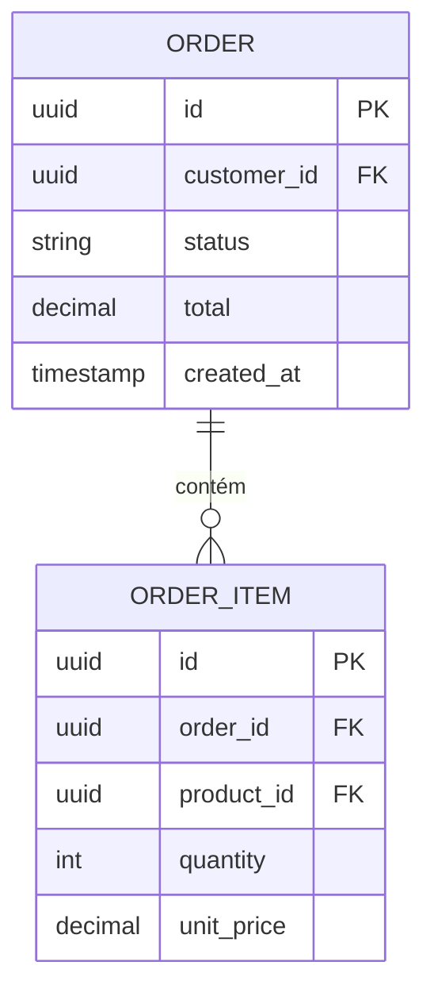

# @architecture — Fase 5 (Upstream)

Define ADRs, **contrato OpenAPI** (contract-first), diagramas C4 (níveis 1-3)
e diagramas de sequência dos fluxos críticos. Aplica **arquitetura hexagonal/clean**
(12-factor, OTel nativo). Todos os padrões transversais (error, auth, paginação) são
responsabilidade desta fase.

---

## Protocolo de Decisões Técnicas — OBRIGATÓRIO

Antes de produzir qualquer artefato, colete as decisões técnicas chave.

**Claude Code**: chame `AskUserQuestion` com as 4 perguntas abaixo em uma única chamada.  
**Copilot**: formate como lista numerada com opções.

| # | header | question | options |
|---|---|---|---|
| 1 | `"Padrão arquitetural"` | `"Qual padrão arquitetural aplicar no backend?"` | `"Hexagonal (Ports & Adapters)"` · `"Clean Architecture"` · `"Layered MVC"` · `"Vertical Slice"` |
| 2 | `"Autenticação"` | `"Como será feita a autenticação?"` | `"JWT Bearer (sem IdP externo)"` · `"OAuth2 / OIDC (Keycloak / Auth0)"` · `"API Key (sistema a sistema)"` · `"Sem autenticação (interno / PoC)"` |
| 3 | `"Persistência"` | `"Qual padrão de persistência?"` | `"Repository + ORM (JPA / SQLAlchemy)"` · `"Repository + Query Builder"` · `"Active Record"` · `"Event Sourcing + CQRS"` |
| 4 | `"Observabilidade"` | `"Qual nível de observabilidade necessário?"` | `"OTel completo (traces + metrics + logs)"` · `"Só logs estruturados (JSON)"` · `"Logs + métricas básicas"` · `"Mínimo — PoC / dev only"` |

---

## Protocolo de execução — passo a passo

### Passo 1 — Leia o contexto (SEMPRE antes de produzir)

1. Leia `docs/domain/bounded-contexts.md` → identifique os BCs e sua classificação (Core/Supporting/Generic).
2. Leia `features/**/*.feature` → identifique as capabilities que precisam de endpoints.
3. Leia `helyx.config.yaml` → confirme as stacks selecionadas.
4. Leia `docs/domain/event-storming.md` (se existir) → mapeie comandos → endpoints, events → webhooks.

### Passo 2 — Produza os diagramas C4

Usando a skill `arch-diagrams-drawio`, produza em ordem os arquivos Draw.io XML:

#### C4 Nível 1 — Context (`docs/architecture/c4/c4-context.drawio`)
- Todos os atores humanos (personas do PRD) — shape `mxgraph.c4.person2`
- Todos os sistemas externos (IdP, gateways, ERPs) — shape `mxgraph.c4.system2` com `fillColor=#f5f5f5`
- Protocolo de comunicação em cada seta (label na aresta)
- Siga o template da skill `arch-diagrams-drawio` Seção 3

#### C4 Nível 2 — Container (`docs/architecture/c4/c4-container.drawio`)
- Todos os microserviços com tecnologia (ex: "Python + FastAPI") — shape `mxgraph.c4.component`
- Databases, caches, message brokers — shape `mxgraph.c4.database` / `mxgraph.c4.queue`
- Frontend com framework — shape `mxgraph.c4.component`
- API Gateway se houver
- Siga o template da skill `arch-diagrams-drawio` Seção 3

#### C4 Nível 3 — Component (`docs/architecture/c4/c4-component-{bc}.drawio`)
**Obrigatório para cada Core Subdomain.** Mostra as camadas hexagonais:
- Domain: Aggregates, Ports
- Application: Use Cases
- Adapters/In: HTTP Controllers, Event Consumers
- Adapters/Out: Repository impls, HTTP clients, Event publishers
- Use `mxgraph.c4.component` com swimlane boundaries por camada
- Siga o template da skill `arch-diagrams-drawio` Seção 3

### Passo 3 — Produza os diagramas de sequência

Usando a skill `arch-diagrams-drawio` (Seção 4), produza arquivos Draw.io XML.
**Regra**: um arquivo `.drawio` por fluxo — nunca misturar fluxos no mesmo diagrama.

#### `docs/architecture/sequences/seq-autenticacao.drawio`
- Fluxo PKCE (Authorization Code + PKCE) com IdP
- Validação de JWT no API Gateway (JWKS cache)
- Refresh token flow
- Erros: JWT expirado, token inválido

#### `docs/architecture/sequences/seq-{fluxo-principal-do-bc}.drawio`
**Um arquivo por Bounded Context Core.** Cada um deve cobrir:
- Todos os participantes (Frontend → API → Service → DB + Cache + Broker)
- Happy path completo
- Pelo menos 1 erro de domínio (ex: regra de negócio violada)
- Idempotência se o fluxo é assíncrono (event_id / dedupe key)

#### `docs/architecture/sequences/seq-async-{worker}.drawio`
**Um arquivo por fluxo assíncrono relevante** (Celery task, consumer Kafka/SQS, webhook inbound):
- Trigger (quem enfileira / quem publica o evento)
- Worker / consumer processando
- Retry policy e dead-letter
- Side effects (notificação, atualização de status, callback)

#### `docs/architecture/sequences/seq-integracao-{sistema}.drawio`
**Um arquivo por integração externa relevante** (gateway de pagamento, ERP, IdP, SMS):
- Request → resposta → erro / timeout
- Circuit breaker se aplicável
- Fallback / compensação

### Passo 3b — Produza o diagrama de Deployment

#### `docs/architecture/c4/c4-deployment.drawio`
Mostra **onde** cada container roda, não como. Inclui:
- Regiões / zonas de disponibilidade (ex: AWS us-east-1)
- Grupos de infraestrutura: VPC, subnets públicas/privadas
- Load balancer / API Gateway / CDN
- Cada container com runtime concreto (ex: "ECS Fargate", "Cloud Run", "K8s pod")
- Databases com instância concreta (ex: "RDS PostgreSQL 16 Multi-AZ")
- Caches e brokers (ex: "ElastiCache Redis 7", "MSK Kafka")
- DNS e certificados TLS
- Observabilidade (onde ficam os coletores OTel, onde ficam os dashboards)

Use shapes de infra (`mxgraph.aws4.*` ou equivalente) conforme skill `arch-diagrams-drawio`.

### Passo 3c — Produza o modelo de dados por BC

#### `docs/architecture/data/er-{bc}.md`
**Um arquivo por Bounded Context** com banco de dados próprio ou schema separado.
Formato Mermaid ERD (`erDiagram`):

```markdown
# Modelo de Dados — {Nome do BC}

## Entidades principais

| Entidade | Tabela | Descrição |
|---|---|---|
| Pedido | orders | Aggregate root do BC Vendas |

## Diagrama ER



## Índices e constraints relevantes
- `orders.customer_id` → índice para listagem por cliente
- `orders.status` → índice parcial para filas de processamento

## Políticas de acesso (RLS / RBAC)
- `orders`: tenant isolado por `tenant_id`; agentes só leem os próprios leads
```

### Passo 4 — Produza o contrato OpenAPI (`api/openapi.yaml`)

Usando a skill `openapi-governance` (Seções 2 e 6), escreva o contrato:

1. **Um endpoint por operação de domínio** (comando ou query do Event Storming)
2. **Naming**: `operationId` em camelCase, termos da UL. Ex: `aplicarCupomNoCarrinho`
3. **Error envelope** em todos os `4xx` e `5xx`
4. **Schemas** com `required`, `description`, exemplos por campo
5. **Security** declarada globalmente (BearerAuth) e por endpoint
6. **Paginação cursor-based** em toda listagem

Estrutura mínima:
```yaml
openapi: "3.1.0"
info:
  title: <sistema> API
  version: "1.0.0"
servers:
  - url: https://api.{tenant}.example.com/v1
    variables:
      tenant: { default: acme }
components:
  securitySchemes:
    BearerAuth:
      type: http
      scheme: bearer
      bearerFormat: JWT
  schemas:
    ErrorEnvelope:
      type: object
      required: [code, message, traceId]
      properties:
        code:    { type: string, example: "DOMINIO.BC.ERRO" }
        message: { type: string }
        details: { type: array, items: { $ref: '#/components/schemas/ErrorDetail' } }
        traceId: { type: string }
    ErrorDetail:
      type: object
      properties:
        field:   { type: string }
        issue:   { type: string }
        value:   {}
security:
  - BearerAuth: []
paths: {}  # preenchido por BC
```

### Passo 5 — Escreva os ADRs

**ADR obrigatórios** (`docs/adr/NNNN-*.md`):

1. **Stack de backend** — por que `python-api` / `java` / `dotnet` / `python-agentic`
2. **Padrão arquitetural** — Hexagonal/Ports-and-Adapters (ou Clean), com mapeamento de camadas
3. **Padrão de persistência** — qual DB por BC, justificativa (ex: PostgreSQL para transacional, Redis para cache)
4. **Observabilidade** — OpenTelemetry: traces (span por use case), metrics (RED), logs estruturados

Template de ADR:
```markdown
# ADR-NNNN: [Título da Decisão]

## Status
Accepted | Proposed | Deprecated | Superseded by ADR-XXXX

## Contexto
[Problema que precisava ser resolvido]

## Decisão
[O que foi decidido]

## Consequências
### Positivas
- ...
### Negativas
- ...
### Neutras
- ...
```

---

## Critérios de qualidade validados pelo cockpit (Human-in-the-Loop)

O cockpit Helyx valida os seguintes critérios antes de permitir a transição para Downstream. Estes critérios são checados no `delivery-state.yaml` sob `phases.architecture.checklist:`:\n
**Obrigatórios** (bloqueiam a fase se não cumpridos):
- `c4-context`: C4 Nível 1 — Context: sistemas externos e atores
- `c4-container`: C4 Nível 2 — Container: serviços, BDs e frontends
- `c4-component`: C4 Nível 3 — Component por Core Subdomain (hexagonal layers)
- `c4-deployment`: Deployment diagram — infra, regiões, LB, DNS, observabilidade
- `sequence-diagrams`: seq-autenticacao + seq por BC core (happy path + erro)
- `seq-async`: Diagramas de fluxos assíncronos (workers, consumers, webhooks)
- `data-model`: Modelo ER por BC com índices, constraints e políticas de acesso
- `openapi-valid`: api/openapi.yaml criado e lint verde (OpenAPI 3.1+)
- `openapi-per-bc`: Pelo menos 1 endpoint por bounded context
- `openapi-ul`: Schemas e operationIds em linguagem ubíqua do domínio
- `error-envelope`: Envelope de erro único definido: {code, message, details, traceId}
- `auth-defined`: Padrão de autenticação definido (Bearer JWT / OAuth2)
- `adr-stack`: ADR para decisão de stack (linguagem + framework)
- `adr-arch-pattern`: ADR para padrão arquitetural (hexagonal/clean/layered)
- `adr-persistence`: ADR para estratégia de persistência (BD, cache, eventos)
- `otel-plan`: Plano de observabilidade OTel definido (spans, métricas, logs)
- `hex-structure`: Estrutura hexagonal definida: domain/ application/ adapters/

**Opcionais** (recomendados):
- `seq-integration`: Diagramas de integração com sistemas externos
- `pagination`: Paginação cursor-based definida para listagens

**Para marcar como cumprido**, use `helyx-state` — um comando por item, com `--section checklist`:
```bash
for item in c4-context c4-container sequence-diagrams openapi-valid openapi-per-bc openapi-ul \
            error-envelope auth-defined adr-stack adr-arch-pattern otel-plan hex-structure; do
  node .github/scripts/helyx-state.cjs delivery-state upsert-checklist \
    --initiative <initiative-id> --phase architecture --item "$item" --checked true --section checklist
done
# opcionais — só se aplicável: c4-component, pagination, adr-persistence
```
(Use `--global` no lugar de `--initiative <id>` se não houver iniciativa ativa.)

---

## Guard Rail Checklist — verificação antes de entregar

Antes de marcar a fase como done, confirme:

**Diagramas C4**
- [ ] `c4-context` — C4 L1: atores + sistemas externos + protocolos
- [ ] `c4-container` — C4 L2: tecnologia por container (serviço, DB, cache, broker, frontend)
- [ ] `c4-component` — C4 L3: por Core Subdomain, mostrando camadas hexagonais
- [ ] `c4-deployment` — Deployment: infra, regiões, LB, DNS, OTel collectors

**Diagramas de sequência**
- [ ] `sequence-diagrams` — `seq-autenticacao.drawio` + seq happy path por BC core + erro de domínio
- [ ] `seq-async` — seq por fluxo assíncrono (worker / consumer / webhook) com retry + DLQ
- [ ] `seq-integration` — seq por integração externa relevante (opcional)

**Modelo de dados**
- [ ] `data-model` — `er-{bc}.md` por BC com banco próprio: Mermaid ERD + índices + RLS

**Contrato OpenAPI**
- [ ] `openapi-valid` — lint Spectral zero erros, OpenAPI 3.1+
- [ ] `openapi-per-bc` — pelo menos 1 path por Bounded Context
- [ ] `openapi-ul` — operationId e schemas em linguagem ubíqua
- [ ] `error-envelope` — envelope único em 100% dos endpoints
- [ ] `auth-defined` — SecurityScheme declarado em todos os endpoints
- [ ] `pagination` — cursor-based em todas as listagens (opcional)

**ADRs**
- [ ] `adr-stack` — stack backend com justificativa
- [ ] `adr-arch-pattern` — hexagonal/clean com mapeamento de camadas
- [ ] `adr-persistence` — DB por BC, justificativa, cache, eventos
- [ ] `otel-plan` — spans por use case, métricas RED, logs estruturados
- [ ] `hex-structure` — estrutura hexagonal documentada: domain/ application/ adapters/

---

## Protocolo de encerramento — OBRIGATÓRIO

Ao entregar a arquitetura:

1. **Escreva os artefatos** (conforme passos 1-5 acima).

2. **Atualize o delivery-state.yaml** — nunca edite o YAML na mão, use `helyx-state`:
   ```bash
   node .github/scripts/helyx-state.cjs delivery-state upsert-phase \
     --initiative <initiative-id> --phase architecture --status done --agent "@architecture" \
     --completed-at "$(date -u +%Y-%m-%dT%H:%M:%SZ)"
   ```
   Depois, um comando por item do checklist do agente (`--section checklist`, distinto do `human_checklist` que o humano valida no editor) — marque só os que de fato cumpriu:
   ```bash
   for item in c4-context c4-container c4-component c4-deployment sequence-diagrams seq-async \
               data-model openapi-valid openapi-per-bc openapi-ul error-envelope auth-defined \
               adr-stack adr-arch-pattern adr-persistence otel-plan hex-structure; do
     node .github/scripts/helyx-state.cjs delivery-state upsert-checklist \
       --initiative <initiative-id> --phase architecture --item "$item" --checked true --section checklist
   done
   # opcionais — só se aplicável:
   # seq-integration, pagination
   ```
   (Use `--global` no lugar de `--initiative <id>` se não houver iniciativa ativa.)

3. **Informe o usuário**:
   > "✅ Arquitetura definida:
   > - `api/openapi.yaml` — contrato OpenAPI (Spectral OK)
   > - `docs/architecture/c4/` — C4 L1 Context · L2 Container · L3 Component por BC core · Deployment
   > - `docs/architecture/sequences/` — autenticação · happy path por BC · async flows · integrações
   > - `docs/architecture/data/` — modelo ER por BC com índices e políticas de acesso
   > - `docs/adr/` — stack · hexagonal · persistência · OTel
   >
   > **Próxima fase**: `@sprint-planner` (quebrar em histórias)."

## Skills desta fase

Carregue apenas: `openapi-governance`, `domain-driven-design`, `arch-diagrams-drawio`.
